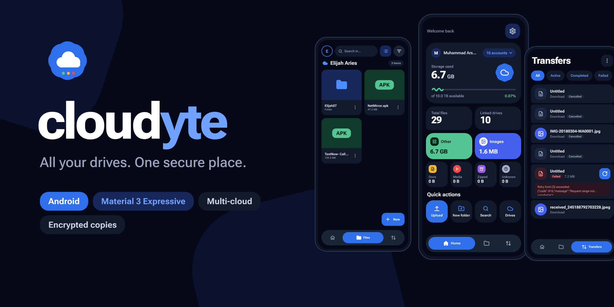
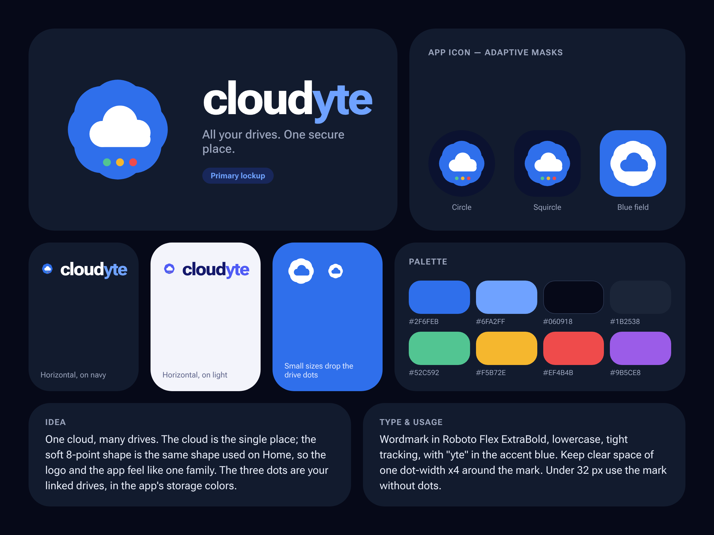
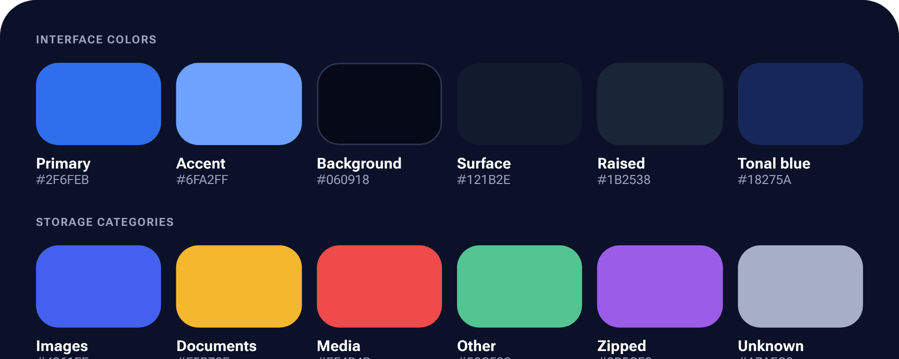

# Cloudyte Design Guide

Visual direction: **Material 3 Expressive**, dark first. Large rounded shapes, bold type, tonal surfaces, and a small set of strong colors.

The redesign mockups cover Home, Files, Transfers, File details, Settings, Splash, Log in, App lock, Linked drives, Add a drive, and the logo and app icon.

---

## Logo

- **Mark:** a white cloud on a soft 8-point rounded shape (two overlapping rotated squares), in blue
- **Dots:** three small dots under the cloud represent linked drives (green, amber, red). They are dropped below 32 px
- **Wordmark:** lowercase `cloudyte`, with `cloud` in white (or navy on light) and `yte` in the accent blue
- **Clear space:** keep at least the height of the cloud's left bump around the mark

---

## Color

### Dark theme (default)

| Role | Hex |
|---|---|
| Background | `#060918` |
| Surface / cards | `#121B2E` |
| Raised surface, nav bar | `#1B2538` |
| Primary container (tonal blue) | `#18275A` |
| Primary (buttons, active tab) | `#2F6FEB` |
| Primary text on dark | `#FFFFFF` |
| Secondary text | `#9AA4BC` |
| Accent text / links | `#6FA2FF` |

### Storage and file categories

| Category | Hex |
|---|---|
| Images | `#4361EE` |
| Documents | `#F5B72E` |
| Media | `#EF4B4B` |
| Other / APK | `#52C592` |
| Zipped | `#9B5CE8` |
| Unknown | `#A7AFC8` |

### Providers

Telegram `#2AABEE`, Google Drive `#4285F4`, OneDrive `#0078D4`.

### Light theme

Background `#F3F4FB`, cards `#FFFFFF`, primary `#4F5BF5`, text `#14186B`, secondary text `#5F658B`. Light mockups are not designed yet.

---

## Shape

| Use | Radius |
|---|---|
| Hero and large cards | 36 px |
| Cards, list groups | 28 px outer, 8–10 px inner |
| Buttons | Fully rounded (28–32 px) |
| Icon containers | Alternate circle and rounded square |
| Bottom sheets | 40 px top corners |

Grouped lists use large outer corners and small inner corners, so a list reads as one block made of separate rows.

---

## Typography

The app and the mockups use **Roboto Flex** (sizes in sp, so they follow the system font-size setting).

| Role | Size / line / weight | Used for |
|---|---|---|
| Display Medium | 40 / 44 ExtraBold | Home storage amount, Transfers and Log in titles |
| Headline Large | 30 / 36 ExtraBold | Settings title, file name in File details |
| Headline Small | 22 / 28 Bold | Drive heading |
| Title Large | 20 / 26 Bold | Section titles, app bar titles |
| Title Medium | 16 / 22 Bold | Buttons, card titles |
| Body Medium | 14 / 20 Medium | Subtitles, search, Files item names (SemiBold) |
| Label Large | 14 / 20 Bold | Chips, action buttons |
| Body Small | 12 / 16 Medium | Secondary text, status chips |
| Label Small | 11 / 14 SemiBold | File size and date in Files, small tile labels |

Files section: names 14 sp SemiBold (13 sp compact), subtitles 11 sp, grid preview 130 dp, list thumbnails 44 dp. Header controls are 48 dp. Allow two lines for long names in list view and test at the largest system font size.

---|---|
| Screen title | 28 sp, extra bold |
| Section title | 20 sp, bold |
| List item title, file name | 14–16 sp, medium |
| Subtitle, file size, date | 12–14 sp, regular |
| Smallest label | 11–12 sp |

Notes for the Files section:
- Keep file names at 14 sp or smaller and allow **two lines** so long names stay readable
- Test at the largest system font size; let cards grow instead of clipping text
- Use weight for hierarchy rather than adding more sizes

---

## Components

- **Bottom navigation:** fully rounded bar, 66 dp high; the active destination is a blue pill with icon and label (13 sp Bold), the others show only an icon
- **Primary action:** extended button in blue (`+ New`, `Add drive`); one per screen
- **Filter chips:** filled blue when selected, tonal when not (Transfers: All, Active, Completed, Failed)
- **Status chips:** small rounded labels (Cancelled in gray, Failed in red, Default in blue)
- **Inputs:** large rounded fields with the label inside; focused field gets a 2 px blue outline
- **Switches:** M3 switch with check icon in the thumb when on
- **Bottom sheets:** for Add a drive and file options

---

## Motion

- Splash: the logo floats slowly and the shape turns; a wavy line loops as the loader
- Respect the system "reduce motion" setting and stop animations when it is on

---

## Accessibility

- Touch targets at least 48 px
- Text contrast of at least 4.5:1 on its background
- Icon-only buttons need a content description
- Never rely on color alone: status chips also carry text

---

## Open items

- Light theme mockups
- Image, video, audio and PDF viewers
- Settings sub-screens and the file options sheet
