<div align="center">

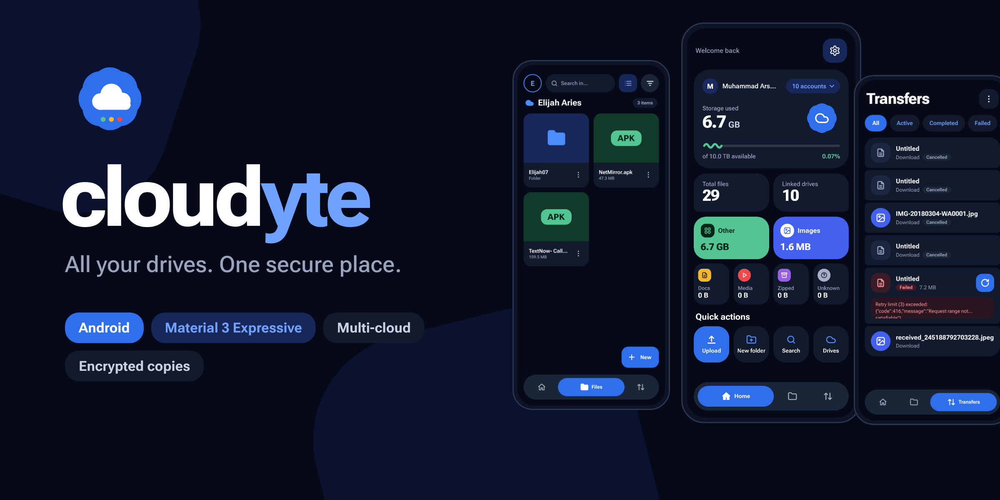

<br>


**One app for all your cloud drives.** Link Telegram Cloud, Google Drive and OneDrive, browse and search them together, move files between them, and protect what matters with on-device encryption and an app lock.

[Screens](#-screens) · [Features](#-features) · [Design](#-design) · [Architecture](#-architecture) · [Getting started](#-getting-started) · [Roadmap](#-roadmap)

</div>

---

> **About the screenshots.** The images in this README are the **Material 3 Expressive UI design** for Cloudyte. They show the target look and feel of the app. See [DESIGN.md](DESIGN.md) for the full design guide.

## 📱 Screens

### Get in

<table>
  <tr>
    <td align="center">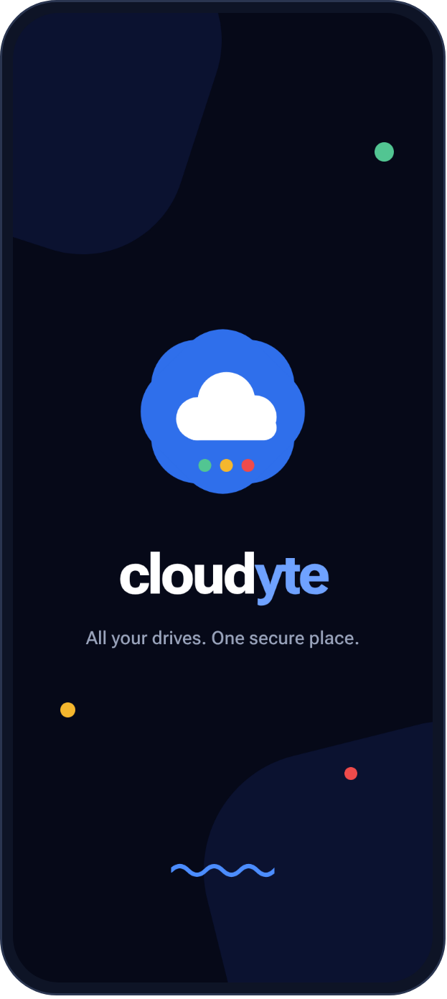<br><b>Splash</b><br><sub>Animated logo and loader</sub></td>
    <td align="center">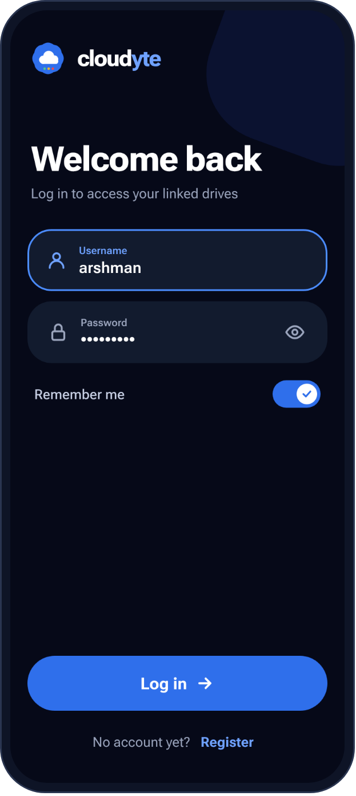<br><b>Log in</b><br><sub>Large fields, thumb-reach button</sub></td>
    <td align="center">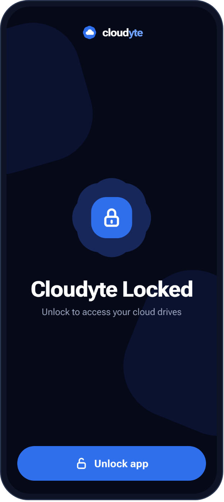<br><b>App lock</b><br><sub>Unlock to open your drives</sub></td>
  </tr>
</table>

### Your drives at a glance

<table>
  <tr>
    <td align="center">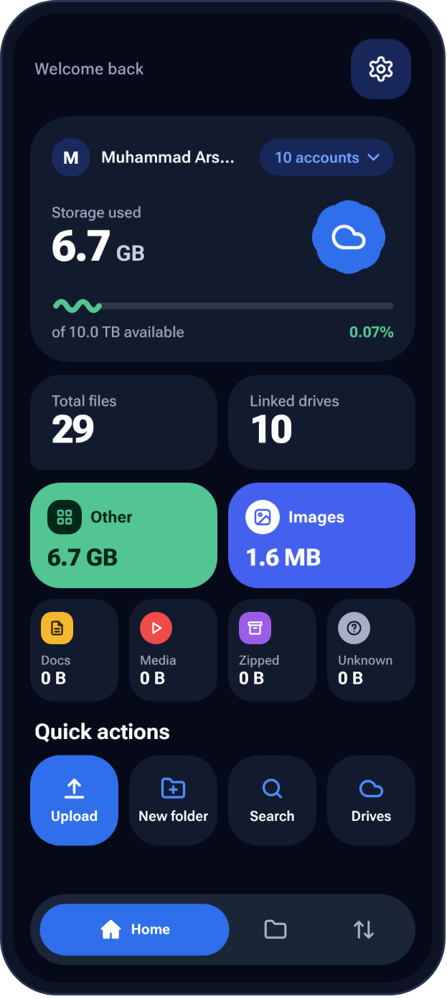<br><b>Home</b><br><sub>Storage, counts, categories, quick actions</sub></td>
    <td align="center">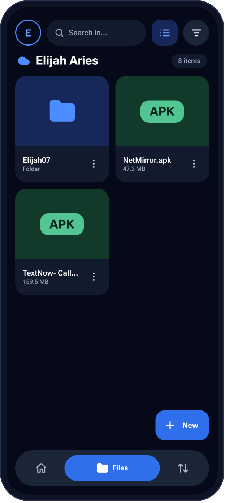<br><b>Files</b><br><sub>Grid view, search, sort, filter</sub></td>
    <td align="center">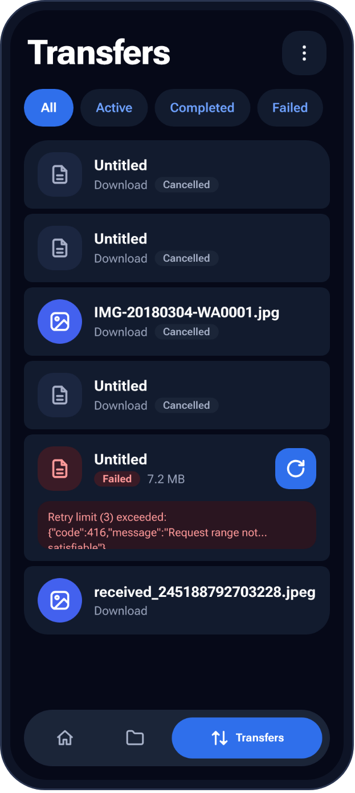<br><b>Transfers</b><br><sub>Queue with status and retry</sub></td>
  </tr>
</table>

### Manage and configure

<table>
  <tr>
    <td align="center">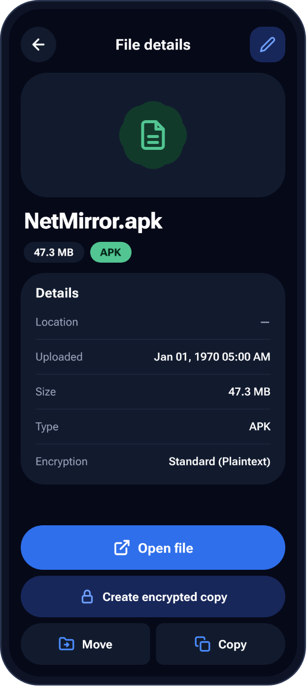<br><b>File details</b></td>
    <td align="center">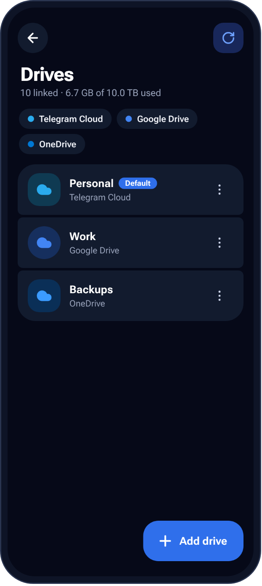<br><b>Linked drives</b></td>
    <td align="center">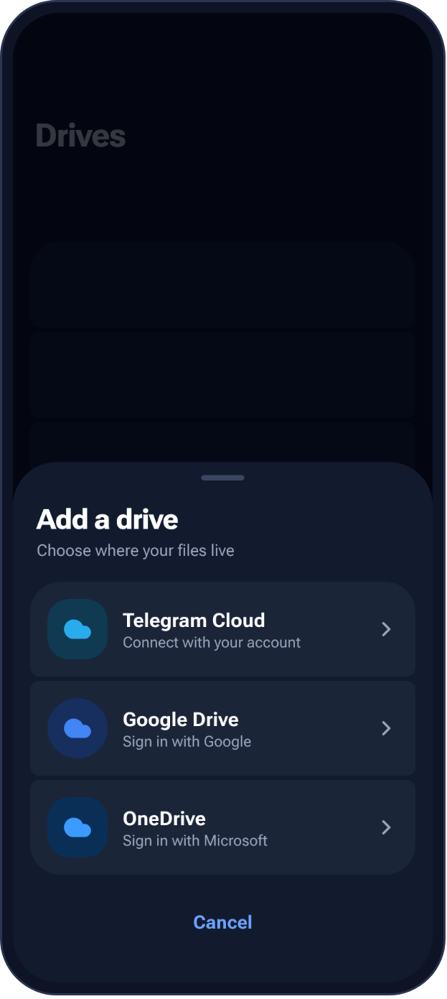<br><b>Add a drive</b></td>
    <td align="center">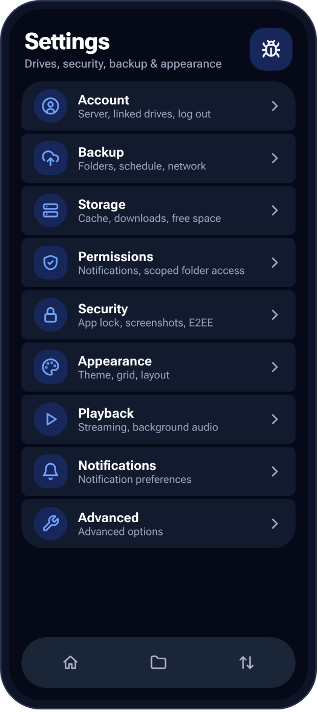<br><b>Settings</b></td>
  </tr>
</table>

---

## ✨ Features

### ☁️ Multi-drive management
- Link several accounts from **Telegram Cloud**, **Google Drive** and **OneDrive**
- Rename, refresh, set a default drive, or disconnect any drive
- One home dashboard with total storage, file counts and a breakdown by category (Images, Documents, Media, Other, Zipped, Unknown)

### 📂 Files
- Grid and list views, search, sort and filter
- Create folders, upload, move, copy, rename and delete
- File details and a per-file options menu
- Cached thumbnails and previews for fast browsing

### 🔄 Transfers
- Upload and download queue with **All / Active / Completed / Failed** views
- Resumable transfers, automatic retry and one-tap manual retry
- Pending transfers recover after a reboot

### 🎬 Built-in viewers
- Images, video, audio (with background playback), PDF and a text editor

### 🔐 Security and privacy
- Optional **end-to-end encrypted copies** of files (AES-256-GCM)
- Keys protected by the **Android Keystore**, with passphrase-based key backup (PBKDF2)
- **App lock** screen
- Option to **block screenshots** and screen recording

### 🗂️ Backup and sync
- Pick folders to back up, set a schedule and network conditions
- Exclusion rules and sync logs

### ⚙️ Settings
- Account, Backup, Storage, Permissions, Security, Appearance, Playback, Notifications and Advanced
- Diagnostics screen for troubleshooting

---

## 🎨 Design

<div align="center">
  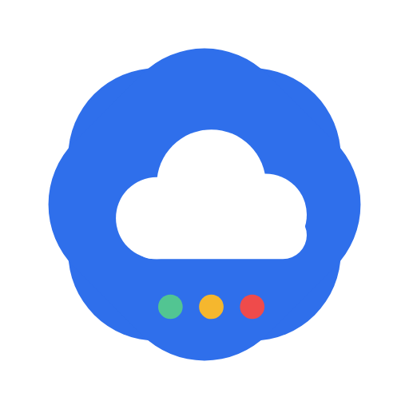
</div>

The logo is one cloud on a soft 8-point shape. The three small dots are your linked drives, in the same colors used for storage categories across the app.

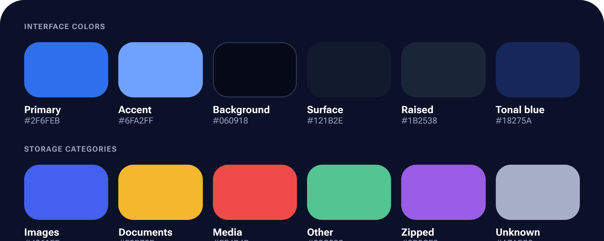

**Design principles**

| Principle | What it means in the app |
|---|---|
| **Expressive shapes** | Large rounded cards, grouped lists with big outer and small inner corners |
| **One clear action** | Each screen has a single primary button in blue |
| **Color with meaning** | Categories and statuses keep the same color everywhere |
| **Readable first** | Bold titles, clear hierarchy, comfortable touch targets (48 px+) |
| **Accessible** | Text contrast of 4.5:1 or better, labels on icon-only buttons, reduced-motion support |

<details>
<summary><b>Logo and app icon board</b></summary>
<br>
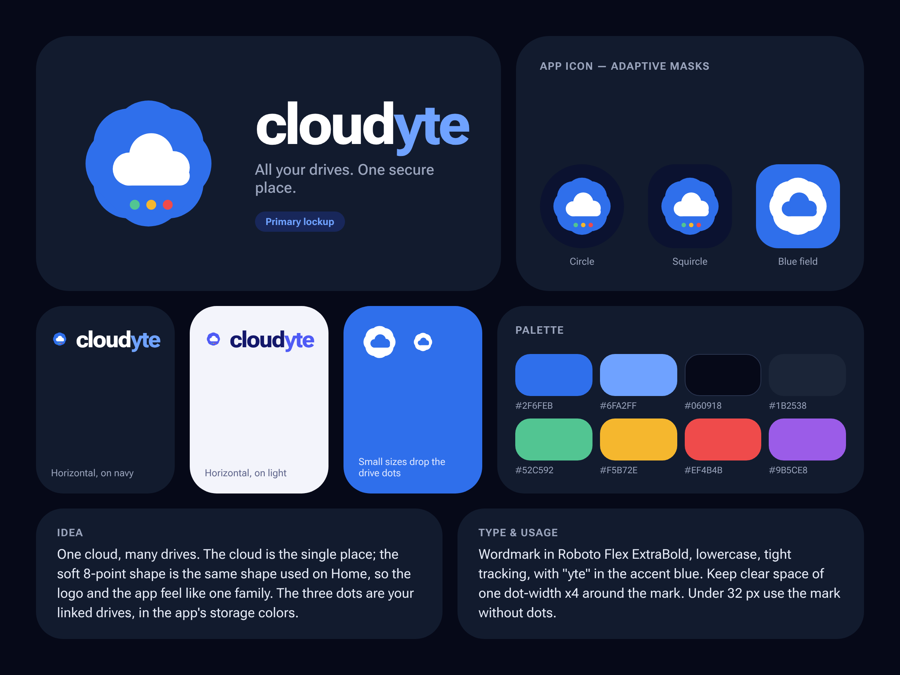
</details>

---

## 🏗️ Architecture

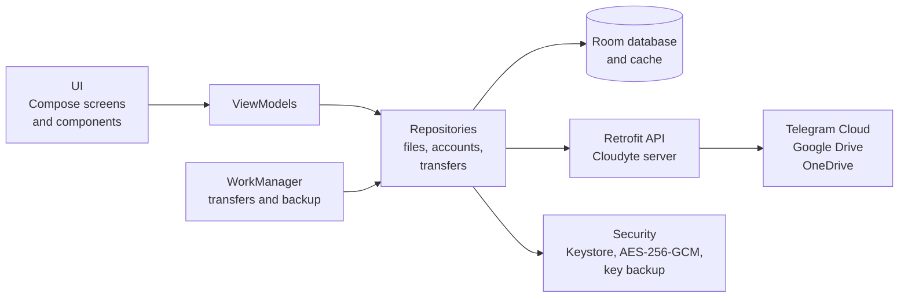

---

## 🧰 Tech stack

| Area | Library |
|---|---|
| Language | Kotlin 2.2.10 |
| UI | Jetpack Compose (BOM 2025.02.00), Material 3 1.4.0-alpha05, Navigation Compose |
| Local data | Room 2.7.0, DataStore Preferences |
| Networking | Retrofit 2.12, OkHttp 4.10, Moshi |
| Images | Coil 2.7 |
| Media | AndroidX Media3 (ExoPlayer, Session, UI) 1.3.0 |
| Background work | WorkManager 2.9.0, foreground services |
| Security | AndroidX Security Crypto, Android Keystore |
| Concurrency | Kotlin Coroutines 1.10 |
| Testing | JUnit, Robolectric, Roborazzi, Compose UI tests |

| | |
|---|---|
| Package | `com.cloudyte.app` |
| Version | 1.1.0 (versionCode 2) |
| Min SDK | 24 (Android 7.0) |
| Target / Compile SDK | 36 |

---

## 📁 Project structure

```
app/src/main/java/com/cloudyte/app/
├── api/           Retrofit client, API models, file repository
├── core/
│   ├── cache/     Thumbnail and preview cache, quota and cleanup
│   ├── network/   Network policy, request correlation
│   ├── security/  Keystore, content keys, encrypted metadata, key backup
│   └── transfer/  Transfer queue, resume, boot recovery
├── data/          Repositories, providers, local and remote data sources
├── db/            Room entities and DAOs
├── domain/        Models and repository interfaces
├── features/      Feature entry points (files, home, accounts, player, transfers, settings)
├── sync/          Backup worker, auto sync, permissions helper
├── ui/
│   ├── components/  Shared Compose components (nav bar, grouped list, sheets)
│   ├── screens/     Screens and view models
│   ├── navigation/  Transitions
│   └── theme/       Colors, typography, shapes, spacing
└── MainActivity.kt
```

---

## 🚀 Getting started

### Requirements
- Android Studio (latest stable) with Android SDK 36
- JDK 17 or newer
- A device or emulator running Android 7.0 (API 24) or higher

### Build and run

```bash
# Debug build
./gradlew assembleDebug

# Install on a connected device
./gradlew installDebug

# Run unit tests
./gradlew testDebugUnitTest
```

The debug APK is created at `app/build/outputs/apk/debug/`. A GitHub Actions workflow (`.github/workflows/build-apk.yml`) is included for CI builds.

### Backend

The app talks to a REST API. The base URL is set in `app/src/main/java/com/cloudyte/app/api/ApiClient.kt` (`API_BASE_URL`). Change it to point to your own server.

### Environment

Copy `.env.example` to `.env` if you add local secrets. It is currently empty.

---

## 🔑 Permissions

| Permission | Why |
|---|---|
| `INTERNET`, `ACCESS_NETWORK_STATE` | Talk to the server and respect network settings |
| `POST_NOTIFICATIONS` | Transfer and backup notifications |
| `FOREGROUND_SERVICE` (data sync, media playback) | Long transfers and background audio |
| `RECEIVE_BOOT_COMPLETED` | Resume pending transfers after a reboot |

---

## 🗺️ Roadmap

- [x] Multi-drive home, files and transfers
- [x] Encrypted copies and app lock
- [x] Material 3 Expressive design: Home, Files, Transfers, File details, Settings, Splash, Log in, App lock, Drives
- [ ] Apply the new design in the app (Compose theme and components)
- [ ] Light theme
- [ ] Redesign the image, video, audio and PDF viewers
- [ ] Redesign Settings sub-screens and the file options sheet
- [ ] Test the Files type scale at the largest system font size

---

## 🤝 Contributing

1. Fork the repo and create a branch: `git checkout -b feature/my-change`
2. Make your change and add or update tests
3. Run `./gradlew testDebugUnitTest`
4. Open a pull request with a short description and screenshots for any UI change

See [DESIGN.md](DESIGN.md) for the visual guidelines.

---

## 📄 License

Add your license here.

<div align="center">
  <sub>Cloudyte · All your drives. One secure place.</sub>
</div>
